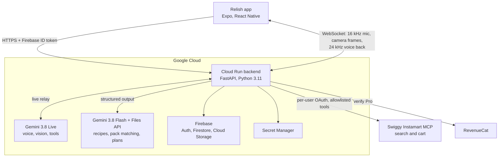
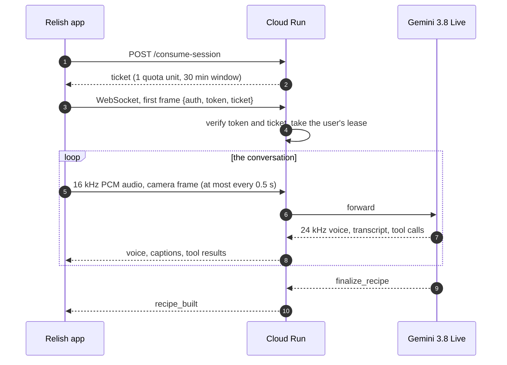
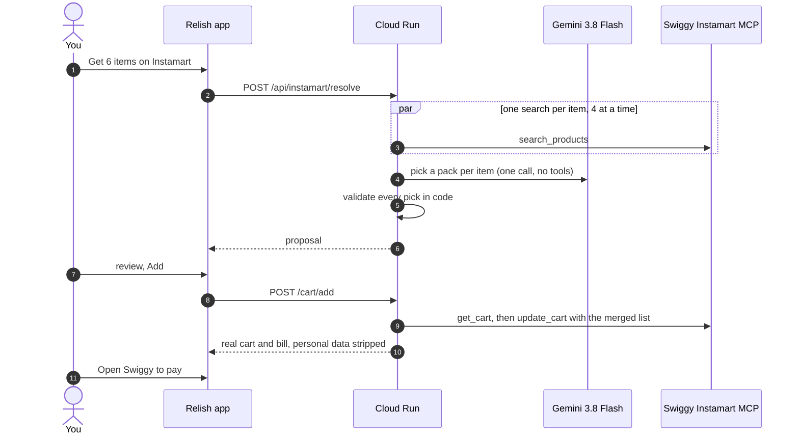

# How Relish is built

The technical side of the submission: the system, where Gemini does the work, the live agent, the Instamart connector, and how we kept it safe and affordable.

[Back to the pitch](./README.md)

---

## At a glance

- **One backend.** A FastAPI service on Cloud Run (`asia-south1`). The app never calls Gemini, Firestore or Swiggy directly.
- **Every AI call is Gemini.** Gemini 3.8 Live for the real-time agent, Gemini 3.8 Flash for everything structured.
- **Commerce through MCP.** Swiggy Instamart's MCP server, called from the backend with a per-user OAuth token.
- **Trust on the server.** Firebase tokens, subscription tier and quota are all checked server-side. Firestore rules deny every client read and write.

---

## Where Gemini does the work

| Feature | Model | What goes in | What comes out |
|---|---|---|---|
| Live cooking, "Cook with me", "Record a cook" | **Gemini 3.8 Live** | Mic audio, camera frames, a persona and language prompt | Voice, transcripts, and **tool calls** the app acts on |
| Video to recipe | **Gemini 3.8 Flash** (+ **Files API** for shared clips) | A YouTube URL, a video file, or pasted text | Recipe JSON: ingredients, quantities, steps, timings |
| End of a live session | **Gemini 3.8 Flash** | The session transcript | A written-up recipe |
| Instamart pack matching | **Gemini 3.8 Flash** | Your list items and indexed product candidates | One pick per item, with units, status and a note |
| Speak your list | **Gemini 3.8 Flash** | "add milk, eggs are done" | Add, remove and tick operations on the list |
| Meal plans | **Gemini 3.8 Flash** | Diet, cuisines, household | A 7-day plan |

Structured calls use a `response_schema`, so the backend gets typed JSON it can validate, not prose it has to parse.

---

## The live agent

Every live surface (cook, studio, record and the assistant hub) shares one WebSocket, `/api/live-studio/ws`, which the backend relays to Gemini 3.8 Live. The app never holds a Gemini key.

**Tools Leo can call:** `next_step`, `prev_step`, `repeat_step`, `set_timer`, `enable_camera`, `disable_camera`, `switch_camera` and `finalize_recipe`. Each mode gets only the tools it needs: in "Record a cook" there is no recipe to step through yet, so Leo gets the camera and `finalize_recipe`, but no step or timer tools.

**Built for a real kitchen:**
- Every tool is pinned to `BLOCKING`, so Leo waits for the result before speaking ("timer's set" only after it is).
- Context window compression keeps long cooks inside the context limit.
- Audio is buffered for 500 ms and merged before playback, and captions are released in sync with the voice.
- Leaving the session closes the socket and drops late frames, so a chef's voice can never play outside live mode.

**Guardrails that keep it affordable:**

| Guardrail | Value |
|---|---|
| Session cap | 30 minutes |
| Idle timeout | 3 minutes with no input or output |
| Sockets per user | 1 (a Firestore lease; the newest connection wins) |
| Camera frames | at most one every 0.5 s |
| Quota | spent when a session starts, refunded if the Gemini call fails |
| Free tier | 3 live sessions a month, 1 recipe import a week |

---

## The Instamart connector

Built on Swiggy's Instamart MCP server (`mcp.swiggy.com/im`) using Swiggy's delegated auth: each user signs in to Swiggy themselves, and the backend holds that user's token.

### Matching
1. Up to 25 items. One `search_products` per item at your saved address, 4 in parallel.
2. Candidates are slimmed to name, brand, pack, price, MRP, unit price, stock and max quantity (at most 14 per item).
3. **One Gemini call for the whole list** (temperature 0.2, structured output). The rules: the smallest in-stock pack that covers the need, substitutions allowed but flagged with a note, never a combo pack for one ingredient, and a `retry_query` when nothing fits.
4. **One retry round** for items that came back with a `retry_query` (for example "toor dal" retried as "arhar dal").
5. **Validation in code.** The pick must point into this request's candidates and be in stock, units are clamped to Swiggy's per-order maximum, and an invented index becomes "not found".
6. **If Gemini is unavailable,** a fallback picks the cheapest in-stock pack and labels it "Picked automatically. Check the pack size."

Measured live: 7 items searched in about **3.3 s**. A full match usually takes 3 to 8 s.

### Cart
Swiggy's `update_cart` replaces the whole cart, so the backend always builds the full list: read the cart, merge the new quantities (or replace, if you choose), then write it once. Carts are bound to one address, so a cart at another address can only be replaced, never silently merged.

### Safety
- **An allowlist of five tools:** `get_addresses`, `search_products`, `get_cart`, `update_cart`, `clear_cart`.
- **A denylist that wins over the allowlist:** `checkout`, `place_order`, `confirm_order`, `get_payment_options`, `check_payment_status`, `create_address`, `delete_address`. Even if one is added to the allowlist by mistake, it cannot be called.
- **Arguments are checked** before any call: product ID format, and a whole-number quantity from 1 to 50.
- **Gemini never sees** tokens, addresses or phone numbers. It gets product data only, has no tools, and answers with indexes into our own list.
- **Tokens are encrypted per user** (Fernet, with a key derived per user by HKDF from a master key in Secret Manager). A token copied into another user's record will not decrypt.
- **Personal data is stripped** from Swiggy's cart responses before they leave the backend. Logs record the tool name, status and latency, never arguments or bodies.
- **Rate limits** per user per day: 30 matches, 150 searches, 120 cart writes. These sit well inside Swiggy's own limits.
- **Fails closed:** with the flag off or the key missing, every Instamart endpoint returns "disabled".

---

## Security and trust

- **Sign-in:** Firebase Auth with Apple, Google, phone or email, and no guest mode. Every request carries a Firebase ID token, and the backend checks it, including whether it has been revoked.
- **Tier verified on the server:** the backend asks RevenueCat directly and never trusts a tier sent by the app.
- **Metering:** quota is spent inside a Firestore transaction and refunded when an AI call fails. AI routes are rate-limited per user.
- **Data isolation:** private records live under `users/{uid}/...`, and Firestore rules deny every client read and write.
- **Secrets:** the RevenueCat secret key and the Instamart token key live in Secret Manager, and only the backend can read them.

---

## What we'd build next

**Voice-to-cart as a Live tool.** Add an `add_to_cart` tool to the live session. It would reuse the existing matcher and cart merge, so "Leo, add an onion" becomes a tool call the backend validates exactly like a tap. Leo then reads back the item and the new cart total.

**Ordering on a spoken yes.** Swiggy's MCP documents a headless checkout (`get_payment_options`, `checkout` with UPI, `check_payment_status`, `confirm_order`). Instamart orders can't be cancelled and `checkout` isn't safe to retry. So this ships only with:
- an explicit spoken confirmation of the read-back bill
- a spending cap set by the user
- a short cancel window held on our side before `confirm_order`
- an order-state screen
- its own security review

**More stores.** Store calls already go through one small interface: a tool allowlist, argument checks and response shapes. Adding a store means writing its connector and its tool list. The matcher, cart review and safety rules stay the same. With more than one store, Relish can split or route a cart by stock, price or delivery time.

---

## Stack

| Layer | Choice |
|---|---|
| App | Expo SDK 54, React Native 0.81, React 19, TypeScript, Expo Router |
| Audio and camera | `expo-audio` (16 kHz PCM capture, 24 kHz playback), `expo-camera` |
| Backend | FastAPI, Python 3.11, WebSockets, Google GenAI SDK |
| AI | Gemini 3.8 Live, Gemini 3.8 Flash, Gemini Files API |
| Cloud | Cloud Run, Cloud Build, Artifact Registry, Secret Manager |
| Data | Firebase Auth, Firestore, Cloud Storage |
| Commerce | Swiggy Instamart MCP, OAuth 2.1 with PKCE |
| Subscriptions | RevenueCat, verified on the server |
| Release | EAS Build, TestFlight (5 iOS builds shipped) |

Source code: [github.com/sushxntt/Relish](https://github.com/sushxntt/Relish)
